<div align="center">

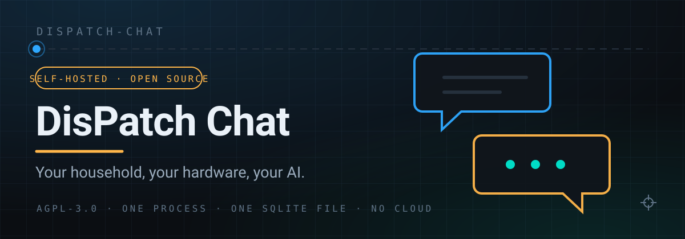

**Your own AI, in a chat app the whole family can use.**

**Current release: 3.0.0** (October 2026) · [what changed](CHANGELOG.md#300--2026-10-18)

[Install](#install) · [Bring your own AI](#bring-your-own-ai) ·
[Add-ons](#add-ons) · [Deployment](#deployment) · [Security](#security) ·
[Documentation](docs/) · [Changelog](CHANGELOG.md) ·
[Contributing](CONTRIBUTING.md)

</div>

<table>
  <tr>
    <td width="50%">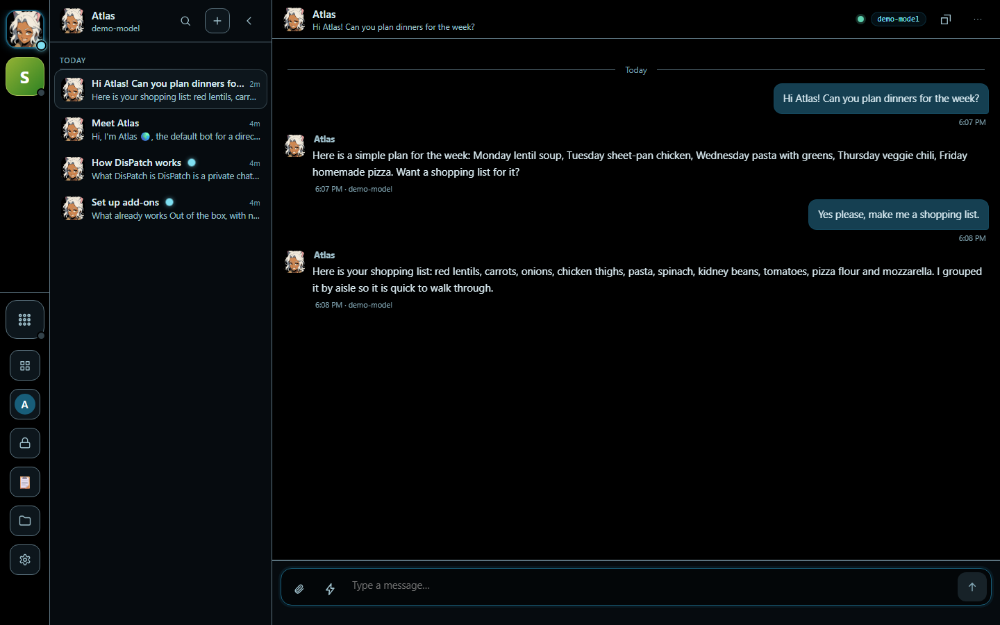<br><sub><b>Chat.</b> Atlas, the default bot, with its shipped avatar, in the Glacier theme.</sub></td>
    <td width="50%">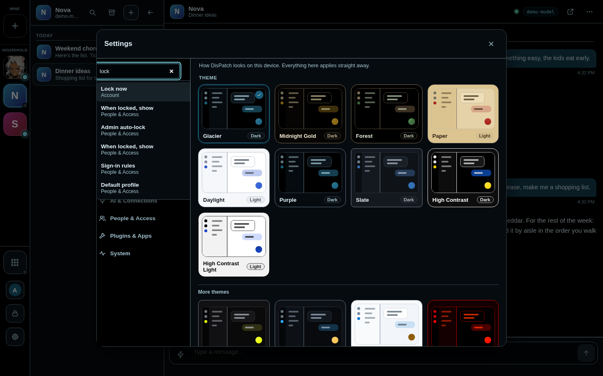<br><sub><b>Settings.</b> Every setting in one searchable place, with Basic and Advanced views.</sub></td>
  </tr>
  <tr>
    <td width="50%">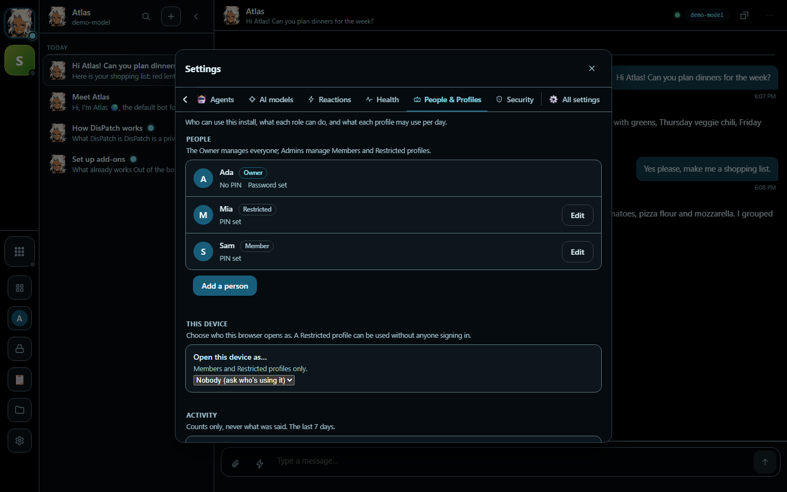<br><sub><b>People &amp; Profiles.</b> An Owner, Members and Restricted profiles for children and guests.</sub></td>
    <td width="50%">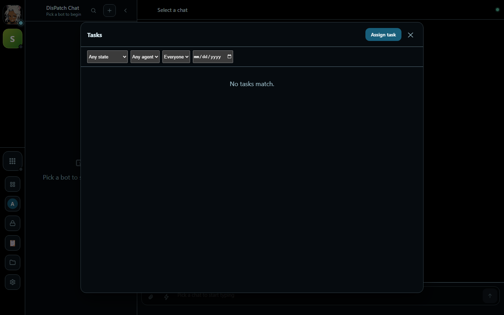<br><sub><b>Tasks.</b> Hand work to an agent and follow it here (empty on a fresh install).</sub></td>
  </tr>
</table>


---

DisPatch is one private chat app for the whole family and every device, with any
AI you like behind it. Voice, pictures, tools and apps are add-ons you switch on
when you want them. It is yours, on your own box: one process, one SQLite file,
no account, no cloud, no telemetry.

## What you get out of the box

- **Atlas**, a general assistant who works as soon as you give him an API key or
  point him at a local model server, with lookups built in: web and news search,
  a page fetch, weather, Wikipedia, exchange rates, the time and a calculator.
- **Three first-run chats** that explain the app: one introduces Atlas, one tours
  how DisPatch works, one walks through setting up the add-ons.
- **Quick actions** on desktop: summarise, translate, fix grammar and other
  ready-made prompts, for any bot.
- **A personality for every bot.** Settings → Bots → Personality has ten presets
  (Sleek assistant, Cat-girl, Warm friend, Patient tutor and more) and an editor;
  `{name}` and `{user}` in the text are filled in for each reply.
- **Profiles and roles.** An Owner, Admins, Members and Restricted profiles for
  children and guests, each with their own PIN or password, daily budgets, time
  limits and a device you can bind to them. A Restricted profile can only talk to
  the characters made for it, by text or, with the voice add-on, by voice.
- **Ten themes**, eight languages, and a phone-installable PWA with push pings.
- **Pictures in chat** from an image API (MiniMax, OpenAI, xAI Grok or any
  OpenAI-compatible images endpoint) or your own image server, and reaction images.
  **Image Studio** (an app in the rail, unlocked devices only) makes pictures on
  demand from the same provider, and the lightbox steps through every picture in
  a thread.
- **One key for everything**: pick MiniMax, OpenAI or xAI, paste one key, and
  chat, pictures and (where offered) knowledge search are set up and tested.
- **Apps** you drop in as folders, and a Settings → Plugins tab that shows what
  is installed and what each one asks to be allowed to do.
- **Connections and characters.** One record per model server (a key is stored
  once, in your keyring or a 0600 file, never in a chat's settings), characters that
  pick a connection, a model, a personality and who may see them, and two starter
  packs: *Animal Friends* for children and *Assistants*.
- **Every setting in one place**, described once (`docs/settings.md`), searchable,
  with Basic and Advanced views and a badge on anything an environment variable sets.
- **Encrypted backups** on a schedule, a restore that checks before it replaces
  anything, a redacted support bundle for bug reports, and export / erase of one
  profile's data.

## Add-ons

- **Voice chat**: talk to a thread hands-free, or type on the call screen while
  replies are still spoken. The separate package
  [DisPatch_Voice](https://github.com/LaserLloyd/DisPatch_Voice); a GPU machine
  for the speech work is optional. It also works on a locked device, on the
  bots marked safe ([docs/extensions.md](docs/extensions.md#voice)).
- **Tool packages**: a package can register more lookups for the bots through
  `register_live_tools` ([docs/extensions.md](docs/extensions.md)).
- **Apps**: trusted packages in `apps/<id>/` with their own page, routes and bot
  ([docs/apps.md](docs/apps.md)).
- **Settings tabs**: an add-on can add a tab of its own to Settings.

## Works with

DisPatch connects to these, all optional. Each one's status shows in
**Settings → Plugins → Works with DisPatch**, and
[docs/integrations.md](docs/integrations.md) has the setup for every one, the
alternatives, and a feature-by-feature matrix of what needs what.

| | What it adds | How it connects |
|---|---|---|
| Any AI API (MiniMax, OpenAI, xAI Grok, OpenRouter, DeepSeek, Anthropic…) | chat; pictures and embeddings where offered | Settings → Connections |
| [StudioForge](https://github.com/LaserLloyd/StudioForge) | your own GPUs as an OpenAI-compatible server that loads models just in time and unloads them when idle | Settings → Connections (found automatically; sends your key as a bearer token) |
| [OpenClaw](https://github.com/openclaw/openclaw) | agent bots with tools, files and long jobs | `openclaw` on PATH or its gateway |
| [DisPatch_Voice](https://github.com/LaserLloyd/DisPatch_Voice) | hands-free voice chat | an add-on package |
| [MailForge](https://github.com/LaserLloyd/MailForge) | an Emails tab for a local email assistant that never sends on its own | runs beside DisPatch |
| An MCP image server (ComfyUI-style) | pictures and pools from your own GPU | `DISPATCH_CLAWFORGE_URL` |
| Offline Wikipedia ([InfoForge](https://github.com/LaserLloyd/InfoForge)) | cited answers from a local Wikipedia copy; the online `wikipedia` lookup works today | `advisor.lookup` |

## Install

Pick your platform below. Methods are listed simplest first, and each block runs top to bottom on a
fresh machine. DisPatch is one Python process with one SQLite file; it needs no GPU and no account.

**Ports:** `8765` (DisPatch: web UI, REST and WebSocket). It is the only port DisPatch opens. Everything
else in the [Ports](#ports) table is something it connects to.

A fresh install is closed to the network until the owner account exists. From the machine DisPatch runs
on, open <http://localhost:8765> and the setup wizard asks for nothing. From any other device, and from
a browser talking to a container, the wizard asks for the one-time **setup token** that the server
prints in its log as `SETUP TOKEN: ...`; each block below says where to read it.

### Windows

#### 1. Docker Desktop (simplest)

Choose this for a PC you can leave signed in. Docker Desktop installs the container runtime, and the
data lives on a volume that survives updates.

```powershell
winget install --id Git.Git -e
winget install --id Docker.DockerDesktop -e
```

Start Docker Desktop once and accept its first-run prompts (WSL 2 backend), then open a new PowerShell
window:

```powershell
git clone https://github.com/LaserLloyd/DisPatch_Chat.git
cd DisPatch_Chat
docker compose up -d
docker compose ps
docker compose logs app | Select-String "SETUP TOKEN"
curl.exe -s http://localhost:8765/api/health
```

The first `up` builds the image from the checkout (two to five minutes, depending on your network and
Docker's cache) and the container reaches `healthy` within 90 seconds. Open <http://localhost:8765> and paste the token into the setup wizard. No
`.env` key is required: an empty one starts a usable server. Optional keys are in `.env.example`
(`HOST_PORT`, `BIND_ADDR=127.0.0.1` to keep it to this PC, `VOICE=1`, `DATA_PATH`). The compose file
publishes the port on all interfaces by default, so a phone on your network can reach it once Windows
Firewall allows port 8765 ([docs/deploy-windows.md](docs/deploy-windows.md)). The compose file fixes the
container name (`dispatch`) and the volume name (`dispatch-data`), so a second copy on the same Docker
host needs different names.

| Pros | Cons |
| --- | --- |
| Data on a named volume; image is rebuilt or replaced without touching it | Image is about 840 MB (about 1.7 GB with voice); Docker Desktop must be running |
| Upgrade is `git pull` then `up -d --build`; rollback is `git checkout` | Neither Docker Desktop nor WSL 2 starts before a Windows sign-in, so it is not an unattended server |
| Same setup as Linux | Agent and host-control features cannot see the Windows host from inside the container |

#### 2. Native, with uv (experimental)

Choose this to try or develop DisPatch without Docker. The server imports and runs on Windows, but the
full backend test suite runs on Linux (WSL on Windows), not natively, so treat this as experimental.

```powershell
winget install --id Git.Git -e
winget install --id astral-sh.uv -e
```

Close PowerShell and open a new window so `git` and `uv` are on `PATH`, then:

```powershell
git clone https://github.com/LaserLloyd/DisPatch_Chat.git
cd DisPatch_Chat\backend
uv sync
uv run uvicorn app.main:app --port 8765
```

`uv` fetches a Python for you (`backend\.python-version` pins 3.12 to 3.14). In a second window:

```powershell
curl.exe -s http://localhost:8765/api/health
```

Open <http://localhost:8765> on this PC and follow the wizard; it needs no token from this machine.

| Pros | Cons |
| --- | --- |
| Smallest install and fastest edit-and-reload loop | Experimental on Windows; no service wrapper, so it stops when you close the window |
| Sees the host, so agent and file features work | You manage updates; data is in `.local\share\local-chat` under your user folder |

### Linux

On a bare Ubuntu or Debian image `git` and `curl` are missing, so the blocks install them first.

#### 1. Docker Compose (simplest)

Choose this for a home server or Raspberry Pi 4/5. Images build for amd64 and arm64.

```bash
sudo apt-get update && sudo apt-get install -y git curl ca-certificates
curl -fsSL https://get.docker.com | sh
git clone https://github.com/LaserLloyd/DisPatch_Chat.git
cd DisPatch_Chat
sudo docker compose up -d
sudo docker compose ps
sudo docker compose logs app | grep "SETUP TOKEN"
curl --retry 30 --retry-connrefused -s http://localhost:8765/api/health
```

Open <http://localhost:8765> (or `http://<this-machine>:8765` from another device) and paste the token
into the wizard. Skip the second line if Docker is already installed; add your user to the `docker`
group to drop `sudo`. No `.env` key is required. To keep it to this machine only, put
`BIND_ADDR=127.0.0.1` in `.env` before `up`. To add voice chat, see [Add voice chat](#add-voice-chat).
If you run your own fork, one line repoints
every image label, the in-app source link and the issue links:

```bash
grep -rlE 'LaserLloyd/DisPatch_Chat|ghcr.io/laserlloyd/' --exclude-dir=.git . \
  | xargs sed -i -e 's|LaserLloyd/DisPatch_Chat|myuser/DisPatch_Chat|g' -e 's|ghcr.io/laserlloyd/|ghcr.io/myuser/|g'
```

| Pros | Cons |
| --- | --- |
| Data on the `dispatch-data` volume, read-only image, a backup before each migration | Image is about 840 MB (about 1.7 GB with voice) |
| Starts at boot (`restart: unless-stopped`) with no unit files | Agent and host-control features cannot see the host from inside the container |
| Upgrade and rollback are one command each | Compose published on all interfaces by default; set `BIND_ADDR` if you do not want that |

#### 2. Native, with uv from a clone (hackable)

Choose this to read or change the code, or to run it in a terminal.

```bash
sudo apt-get update && sudo apt-get install -y git curl ca-certificates
curl -LsSf https://astral.sh/uv/install.sh | sh
source "$HOME/.local/bin/env"
git clone https://github.com/LaserLloyd/DisPatch_Chat.git
cd DisPatch_Chat/backend
uv sync
uv run uvicorn app.main:app --port 8765
```

In a second terminal: `curl -s http://localhost:8765/api/health`. The server binds loopback, so the
wizard needs no token from this machine. Add `--host 0.0.0.0` to reach it from other devices (then the
wizard on those devices asks for the token printed in this terminal).

| Pros | Cons |
| --- | --- |
| Smallest and fastest: reload on change, run the tests | Stops when the terminal closes; no autostart |
| Sees the host, so agents and file features work | You manage uv, Python and updates |

#### 3. Native, as a systemd user service

Choose this for an always-on box where DisPatch should reach things in your home directory (an agent
CLI, for example). It is method 2 plus a unit.

```bash
sudo apt-get update && sudo apt-get install -y git curl ca-certificates
curl -LsSf https://astral.sh/uv/install.sh | sh
source "$HOME/.local/bin/env"
git clone https://github.com/LaserLloyd/DisPatch_Chat.git ~/dispatch
cd ~/dispatch/backend
uv sync --frozen --no-dev
mkdir -p ~/.config/systemd/user
sed "s#__APP_DIR__#$HOME/dispatch#g" ~/dispatch/deploy/systemd/dispatch-user.service > ~/.config/systemd/user/dispatch.service
systemctl --user daemon-reload
systemctl --user enable --now dispatch
sudo loginctl enable-linger "$USER"
curl --retry 30 --retry-connrefused -s http://localhost:8765/api/health
journalctl --user -u dispatch | grep "SETUP TOKEN"
```

`enable-linger` is the step people forget: without it the service stops when your last session ends and
does not start at boot. The unit binds `0.0.0.0`, so paste the token printed by the last command into the wizard.
For a locked-down system service run by its own account, see
[docs/deploy-bare-metal.md](docs/deploy-bare-metal.md).

| Pros | Cons |
| --- | --- |
| Autostart, restart on failure, logs in `journalctl` | Needs systemd and the linger step; no container isolation |
| Agent and host features work | You update it by hand (`git pull`, `uv sync`, restart) |

#### 4. Docker stack with StudioForge (a local model server)

Choose this when you want DisPatch and a local GPU model server (StudioForge) on one private network,
with DisPatch's first connection already pointing at it. It needs an NVIDIA GPU and the
[NVIDIA Container Toolkit](https://docs.nvidia.com/datacenter/cloud-native/container-toolkit/latest/install-guide.html).

```bash
git clone https://github.com/LaserLloyd/DisPatch_Chat.git
cd DisPatch_Chat
cp deploy/compose/stack.env.example deploy/compose/stack.env
sed -i 's/^STACK_MODEL=.*/STACK_MODEL=your-model-id/' deploy/compose/stack.env
P="sudo docker compose -f deploy/compose/stack.yml --env-file deploy/compose/stack.env"
$P up -d
$P ps
$P logs dispatch | grep "SETUP TOKEN"
```

Replace `your-model-id` with the model you will load in StudioForge. `STACK_MODEL` is the one key to
set; add `SF_OWNER_PASSWORD` (10 or more characters) to `stack.env` to choose the StudioForge owner
password, otherwise one is generated into `/data/owner-password.initial` on its volume. Put your GGUF
files in `deploy/compose/models/`, load one at <http://localhost:8080>, and give the DisPatch
connection a StudioForge key (see [docs/deploy/stack.md](docs/deploy/stack.md)). Podman, AMD and
no-GPU variants, and the optional offline-Wikipedia profile are in the same page.

| Pros | Cons |
| --- | --- |
| Chat and model server wired together, volumes for both | Needs an NVIDIA GPU and the container toolkit |
| One command to start, update and stop both | Larger download; StudioForge builds its engine on first use |

### macOS

Not tested by us and not part of CI. Docker Desktop for Mac should run Docker method 1 as written
(`brew install git` and `brew install --cask docker`, then the same `git clone`, `docker compose up -d`
and `docker compose logs app | grep "SETUP TOKEN"` lines without `sudo`). The native method should work
with `brew install git uv`, then Linux method 2 from the `git clone` line.

### Add voice chat

Voice is the separate [DisPatch_Voice](https://github.com/LaserLloyd/DisPatch_Voice) add-on. In Docker,
build the image with it and ffmpeg and libopus included (about 1.7 GB, and the build takes up to five minutes), then press **Download** under Settings, Voice:

```bash
echo "VOICE=1" >> .env
sudo docker compose up -d --build
```

On a native install, install the add-on into DisPatch's own environment and the two system programs, then
restart DisPatch and use Settings, Voice (details: [docs/voice.md](docs/voice.md)). Run the last line from your DisPatch clone's top folder. A later `uv sync` removes a pip-installed add-on, so repeat it after one:

```bash
sudo apt-get update && sudo apt-get install -y ffmpeg libopus0
git clone https://github.com/LaserLloyd/DisPatch_Voice.git ~/DisPatch_Voice
cd backend && uv pip install --python .venv/bin/python ~/DisPatch_Voice
```

### Upgrade and uninstall

| Method | Upgrade | Uninstall |
| --- | --- | --- |
| Docker Compose | `git pull`, then `docker compose up -d --build` (or `docker compose pull && docker compose up -d` if you set `IMAGE` to a published image). The first start of a new version copies the databases to `/data/backups/<version>-<time>/` and keeps the newest 5. Roll back with `git checkout <tag>` and the same command | `docker compose down` keeps the `dispatch-data` volume; `docker compose down -v` deletes your chats |
| Native (uv, systemd) | `git pull`, `cd backend && uv sync` (add `--frozen --no-dev` for the service), then restart | Remove the unit (`systemctl --user disable --now dispatch`) and the clone; your data stays in `~/.local/share/local-chat` |
| Stack | Same as Docker Compose, with the `-f deploy/compose/stack.yml --env-file deploy/compose/stack.env` flags | `down` keeps the four volumes; `down -v` deletes them |

Back up a Docker install with the app stopped:
`docker run --rm -v dispatch-data:/data:ro -v "$PWD":/backup alpine tar czf /backup/dispatch-data.tgz -C /data .`
and restore by extracting into a fresh volume, then `chown -R 1000:1000 /data`
([docs/deploy-docker.md](docs/deploy-docker.md)). `down -v` and `docker volume rm` are the only ways to
lose the data by accident.

### First run

The wizard has six short steps: the owner account, a model server (it looks for StudioForge, LM Studio
and Ollama, or takes an API key), voice, the family (children get a Restricted profile and the *Animal
Friends* characters), network exposure, and a checklist. Every step is also available from the command line
([docs/first-run.md](docs/first-run.md)). After that, everything is in the gear menu: **Connections**
(the servers you talk to), **Bots** (characters), **All settings** (every setting, searchable, with a Basic
and Advanced switch) and **System, Backups** ([docs/settings.md](docs/settings.md),
[docs/connections.md](docs/connections.md), [docs/characters.md](docs/characters.md),
[docs/backups.md](docs/backups.md)).

### Ports

| Port | Who | Notes |
|---|---|---|
| **8765** | DisPatch (this app: web UI, REST and the WebSocket) | The only port to expose. Loopback unless you say otherwise (`--host`; in Docker see the bind-address note below). |
| 1234 | StudioForge's OpenAI-compatible gateway, or LM Studio | Where the wizard looks first. A connection to it, not something DisPatch opens. |
| 8080 | StudioForge's control panel, or a llama.cpp server | Optional pane (`connections.studioforge_panel`). |
| 1235 | StudioForge's watchdog sidecar (MCP and `/health`) | Published by the Docker stack (`deploy/compose/stack.yml`), not opened by DisPatch. |
| 11434 | Ollama | Found by the wizard. |
| 8090 | InfoForge's offline-Wikipedia server (`kiwix-serve`) | Only the `infoforge` command talks to it; see [docs/integrations.md](docs/integrations.md). |
| 3080 | `dsh web` (the optional coding-agent pane) | Loopback only. |

DisPatch never opens another port. Everything above except 8765 is somewhere you
*connect to*.

Bind address in Docker: the plain `docker-compose.yml` publishes 8765 on `0.0.0.0` by default
(reachable from your LAN; set `BIND_ADDR=127.0.0.1` to keep it to this host), while the
[stack](docs/deploy/stack.md) (`deploy/compose/stack.yml`) publishes every port on `127.0.0.1` by default.

## Screenshots

<table>
  <tr>
    <td width="50%">
      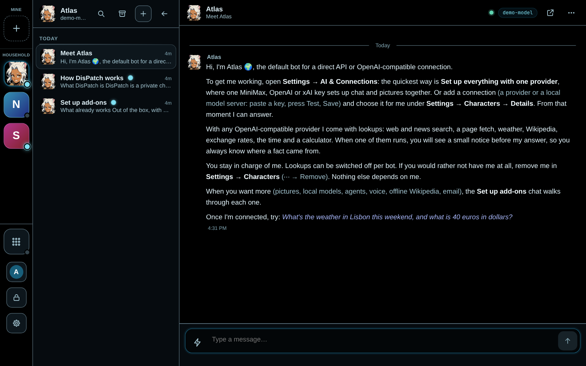
    </td>
    <td width="50%">
      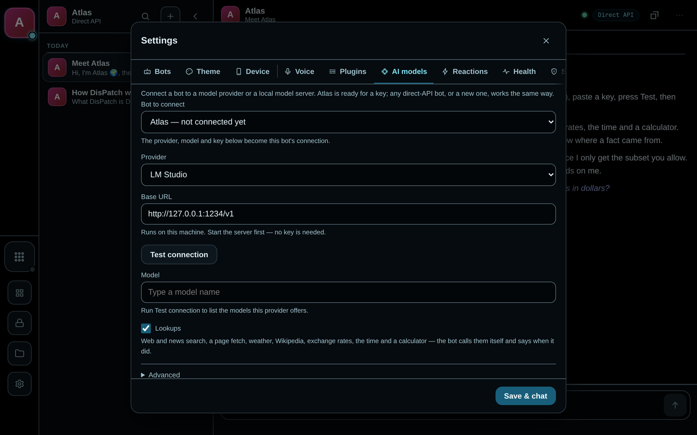
    </td>
  </tr>
  <tr>
    <td align="center"><em>First run: two chats that explain the app</em></td>
    <td align="center"><em>Settings → AI models: connect Atlas in a minute</em></td>
  </tr>
  <tr>
    <td width="50%">
      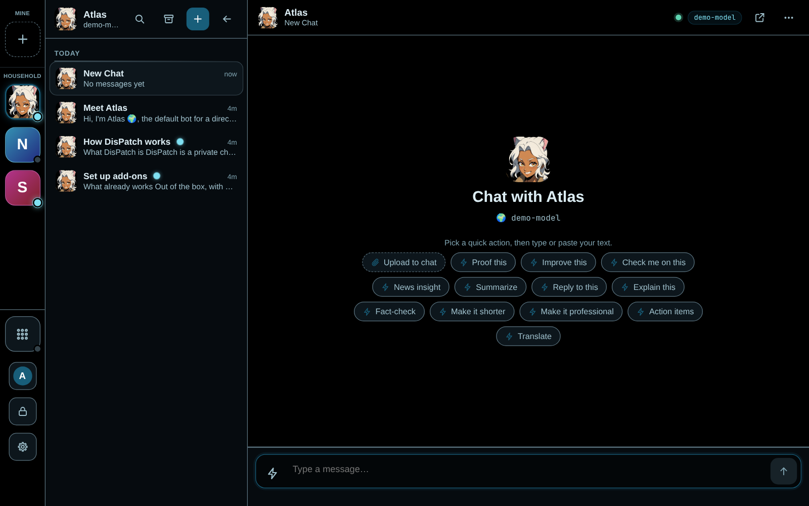
    </td>
    <td width="50%">
      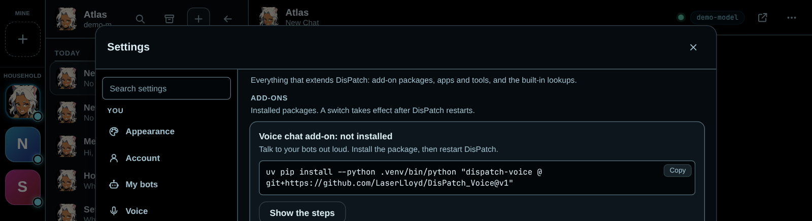
    </td>
  </tr>
  <tr>
    <td align="center"><em>Quick actions on desktop</em></td>
    <td align="center"><em>Settings → Plugins</em></td>
  </tr>
  <tr>
    <td width="50%">
      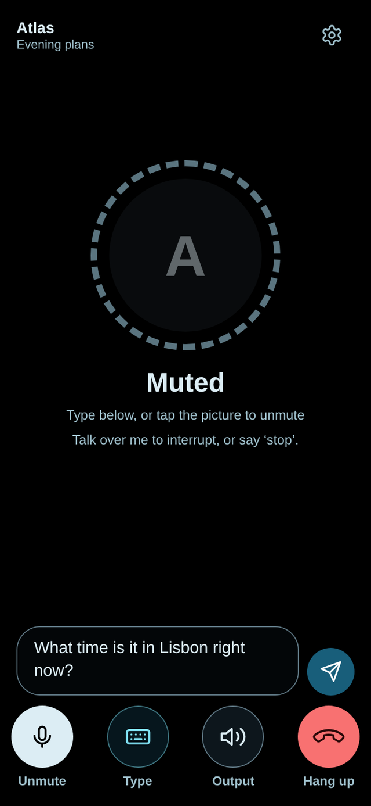
    </td>
    <td width="50%"></td>
  </tr>
  <tr>
    <td align="center"><em>Voice chat (add-on)</em></td>
    <td></td>
  </tr>
</table>

### The rest of the app

A demo install with three fictional assistants — the same app on a desktop and
on a phone, in a few of the ten themes.

<table>
  <tr>
    <td width="50%">
      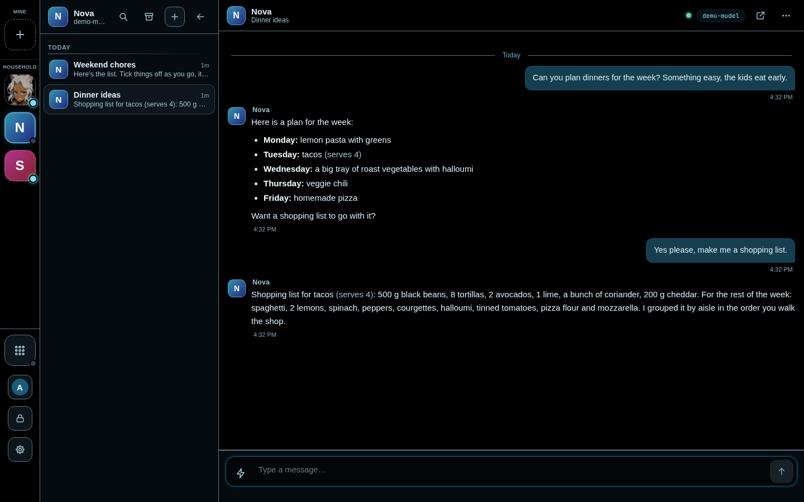
    </td>
    <td width="50%">
      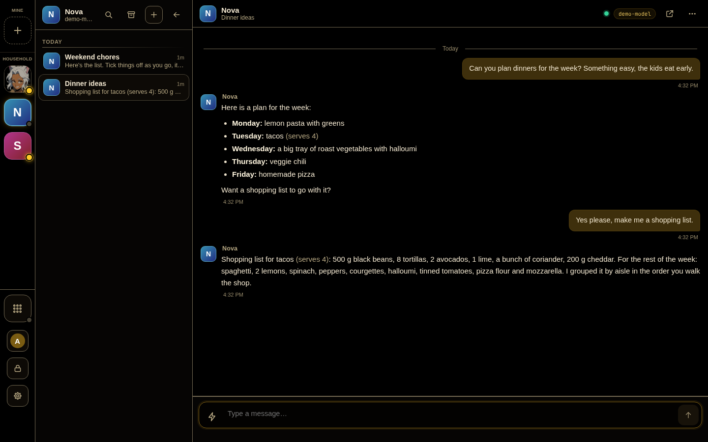
    </td>
  </tr>
  <tr>
    <td align="center"><em>Glacier (default) — markdown and sortable tables</em></td>
    <td align="center"><em>Midnight Gold — code blocks</em></td>
  </tr>
  <tr>
    <td width="50%">
      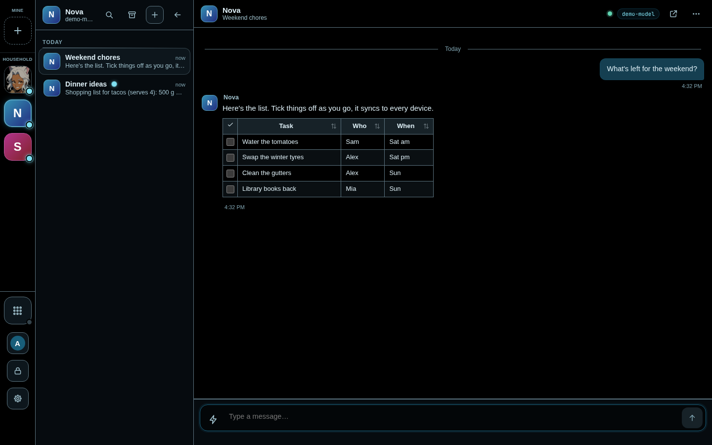
    </td>
    <td width="50%">
      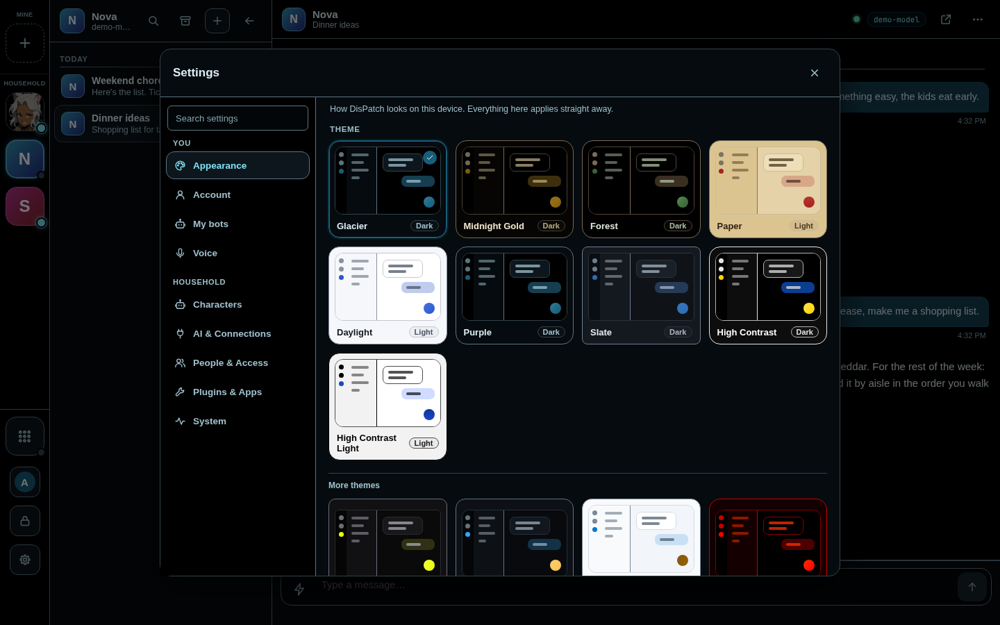
    </td>
  </tr>
  <tr>
    <td align="center"><em>Checklist tables — ticks sync to every device</em></td>
    <td align="center"><em>Settings → Theme — ten skins, live previews</em></td>
  </tr>
</table>

<table>
  <tr>
    <td width="33%">
      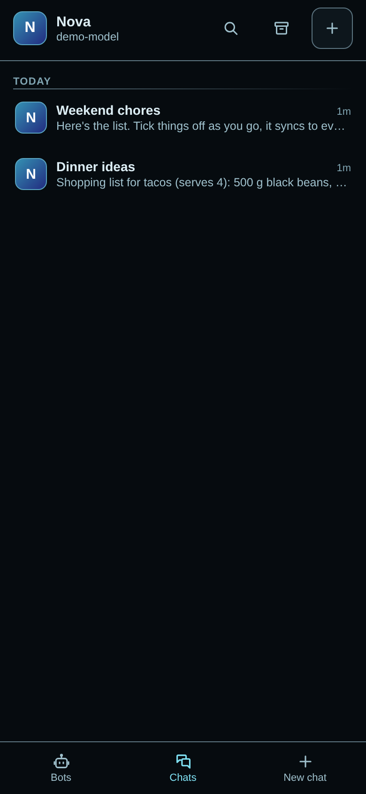
    </td>
    <td width="33%">
      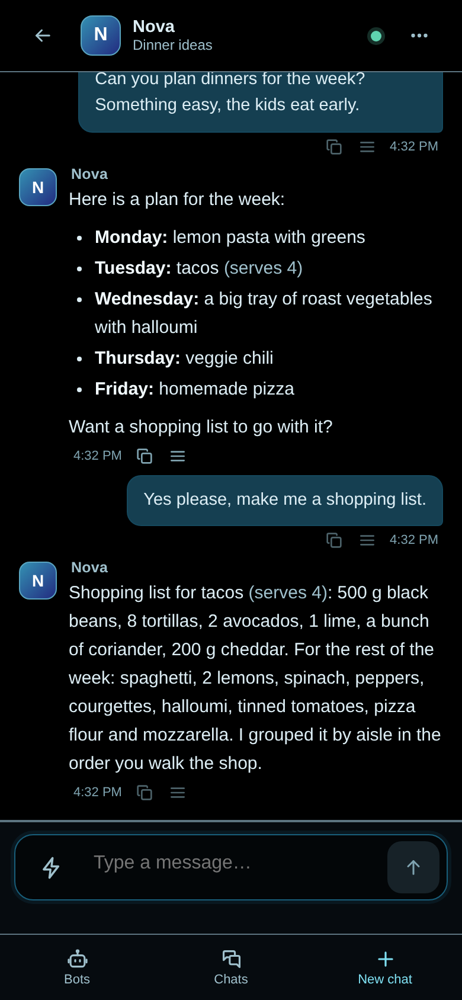
    </td>
    <td width="33%">
      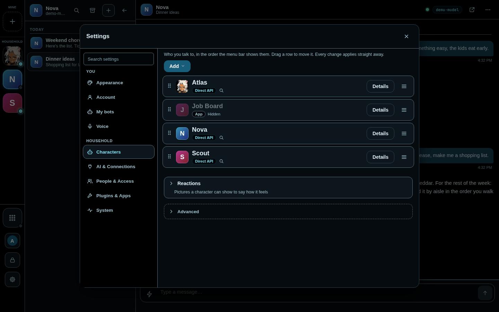
    </td>
  </tr>
  <tr>
    <td align="center"><em>Phone — thread list</em></td>
    <td align="center"><em>Phone — conversation</em></td>
    <td align="center"><em>Settings — the bot roster</em></td>
  </tr>
</table>

## What's new in 3.0

- **Closed until it has an owner.** A fresh install answers only the machine it runs on until
  an owner exists; any other machine finishes setup only with the one-time setup token printed
  in the server log (`docker compose logs app` in Docker). An install that already has a PIN is
  unaffected.
- **Profiles and roles.** Owner, Admin, Member and Restricted replace "PIN or Safe Mode". Each
  profile has its own PIN or password, budgets and session timeout, and every route declares the
  permission it needs.
- **One settings store.** Every user-facing setting is described once (64 documented keys, see
  [docs/settings.md](docs/settings.md)), kept in `chats.db`, overridable by environment variable
  and editable in **Settings, All settings** or over `GET`/`PATCH /api/settings`.
- **Connections.** One record per model server, keys in the secret store, an actionable **Test**
  and **Find servers**. StudioForge is recognised automatically and sent its bearer key
  ([docs/connections.md](docs/connections.md)).
- **Agents and tasks.** Owners and Admins publish configured agents (OpenClaw or Claude Agent);
  people dispatch tasks with a live timeline, approvals for destructive tools, budgets and an
  audit row ([docs/agents.md](docs/agents.md)).
- **Backups you can trust.** Scheduled encrypted archives (AES-256-GCM), a restore that checks
  first, and an automatic backup plus `--dry-run` before any database migration
  ([docs/backups.md](docs/backups.md)).
- **A Docker stack.** `deploy/compose/stack.yml` runs DisPatch with StudioForge, and optionally
  InfoForge, on one private network ([docs/deploy/stack.md](docs/deploy/stack.md)).
- **The first-run wizard and settings are driveable over the API** (`/api/wizard/*`,
  `/api/people*`, `/api/settings`), and the backend now runs on native Windows. The full list,
  with the breaking changes, is in [CHANGELOG.md](CHANGELOG.md).

## What's new in 2.3

- **A default bot that just needs a key.** Atlas is the new first bot: a direct-API
  assistant with lookups. Two chats on first run explain Atlas and the app.
- **Connect an AI now connects a bot.** The AI models tab writes the provider into
  Atlas (or any direct-API bot, or a new one); the Bots tab can add, edit and
  remove bots.
- **Quick actions** on desktop, and a **Plugins tab** with room for add-ons' own
  Settings tabs. Settings is reordered by how often you use each tab.
- **Tool packages**: add-ons can register their own lookups.
- **2.3.4, voice on locked devices:** a Safe-Mode device can talk to a `safe` bot
  by voice. Every voice turn runs with the same locked rules, and the same daily
  budget, as a typed Safe-Mode message. Needs DisPatch Voice 1.3.3 or later.
- **2.3.6, Personality:** a preset picker and prompt editor per bot, in
  Settings → Bots (ten presets in `backend/app/personas/`).
- **2.3.7, integrations:** pictures from MiniMax, OpenAI or xAI Grok; one key
  sets up chat and pictures together; a *Works with DisPatch* catalog in
  Settings → Plugins; a "Set up add-ons" guide chat; see
  [docs/integrations.md](docs/integrations.md).
- **2.3.8:** Settings is laid out for a 360px phone.
- **2.3.9, pictures:** Image Studio, and a lightbox gallery with arrow keys, side
  buttons and swipe.
- **2.4.0, hide on unlocked devices:** a bot can stay on the locked family tablet
  and off your own screen; Settings → Device can bring hidden bots back per device.
- Web Push pings, real streaming for legacy `api:` bots and Safe-Mode advisors
  arrived on the way; the [changelog](CHANGELOG.md) has all of it.

## What it is

DisPatch Chat is a small, fast application you host yourself. It looks and feels
like a normal messaging app — threads, avatars, markdown, file sharing, search,
a phone-installable PWA — and it can talk to AI agents running on your own
machine as well as to the other people in your household.

It is deliberately **one process and one SQLite file**. No Redis, no Postgres,
no message broker, no build step. It runs comfortably on a Raspberry Pi.

**Not** a Slack replacement. **Not** end-to-end encrypted (see
[Security](#security) for exactly what that means). It is a private chat you own.

### The shape of it, honestly

A whole household can use one install, and everyone who unlocks it sees the same
threads, so people really can talk to each other in here. That works, and some
families use it that way.

But it was built first as a **front door to an AI backend** — originally an
agent runtime like [OpenClaw](docs/agents.md) running on your own machine — that
happens to look and feel like the messaging app everyone already knows. The
bots are participants in the threads, not a feature bolted onto a chat app.
If what you want is a private person-to-person messenger, there are better
tools; if what you want is for your family to be able to talk to the thing
running on the box in the cupboard, this is the one.

You no longer need an agent stack for that: **Connect an AI** (below) points a
bot at a model provider's API directly. The agent path is still what you want
if you need a thing that can *use tools and act on the machine*, and it is
still the one that has to run on the same host.

Since 3.0 it has **accounts**: an Owner, Admins, Members and Restricted profiles,
enforced on the server for every route. Conversations are still one shared
household space (no per-person threads yet); roles decide what each person can
*do* and which characters they can reach. The design and what is built are in
[docs/design/multi-user.md](docs/design/multi-user.md); the upgrade that keeps an
existing install's PIN and history is in [docs/security.md](docs/security.md#upgrading-to-30).

## Features

**Chat**
- Threads per conversation, with pinning, archiving, rename and full-text search
- Markdown with syntax-highlighted code blocks, copy buttons, and collapsible JSON
- Image, video and arbitrary file attachments with inline previews
- Live streaming replies, a status line naming what the run is doing, a
  collapsible "what the agent is doing" panel, and a Stop button
- Regenerate (with the alternates kept), edit-and-rerun, quote/reply, thumbs
  feedback, and dropping a message from the context
- Per-thread model and thinking-level override, with a context meter
- Interactive checklist tables whose ticks persist and sync across devices
- Drafts per thread, a persisted outbox and offline reading — installs to a
  phone home screen as a PWA

**Images & media delivery**
- Agent- and script-posted pictures arrive as an instant placeholder in the
  thread that resolves into the image when the render lands — failures turn
  the placeholder into a visible warning, never silence
- Per-bot avatar pools and one-shot reaction overlays, topped up automatically
- Every thumbnail opens its full-resolution original in the lightbox, which steps
  through the thread's pictures (arrow keys, side buttons or a swipe)

**Tools & apps (plugins)**
- Embed your own projects as switchable modules: a static directory, a URL, or
  a trusted app package with its own backend routes, UI and bot
  (`apps/<id>/`, [docs/apps.md](docs/apps.md))
- Tools open full-page inside the app — or in a new browser window for pages
  that refuse framing — from one Tools button in the rail
- Installable **extensions** that plug a whole feature in — voice chat is the
  DisPatch Voice add-on — with every security gate kept in DisPatch
  ([docs/extensions.md](docs/extensions.md))

**Access control**
- **Profiles and roles**: an Owner, Admins (password), Members (own PIN) and
  Restricted profiles; sessions idle-expire per role, and a device can be bound to
  a profile or remembered for a sliding window if you choose
- A **Restricted** profile — a family tablet on the kitchen counter, a child, a
  guest — can read and send to the characters made for it, with all media stripped
  server-side, daily per-profile budgets and time limits; every management route
  and WebSocket action declares the permission it needs and answers 403 otherwise
- **One-way file drop**: a Restricted device can send you a file without being
  able to browse or retrieve anything

**Operations**
- Built-in **host dashboard**: health, storage, database integrity, backup
  status, and a checklist that tells you what is misconfigured and how to fix it
- Automatic rotating database backups with integrity verification
- Crash recovery that reconciles interrupted conversations rather than losing them
- **Local viewer**: tap a path in a message and the file opens inside the app —
  an HTML page or a whole static site, a PDF, markdown, a log, an image, a
  video, a folder listing. The server reads the bytes, so it works from a phone
  as well as the desktop. It serves nothing until you name a folder, and never
  serves secrets, dotfiles or system paths; unlocked sessions only

**Interface**
- Eight languages — English, العربية, Deutsch, Español, Français, 日本語,
  Português, 中文 — including full right-to-left layout
- Ten built-in themes — Glacier (default), Midnight Gold, Forest, Paper,
  Daylight, Classic Purple, Electric Yellow, Night Red and two LaserLloyd
  skins — picked per device from Settings → Theme, each
  with a live preview. A theme is one fixed skin; there is no separate
  light/dark switch
- Keyboard-navigable, screen-reader labelled, WCAG AA contrast in every theme

**AI (optional)**
- **Bring your own model provider**: point a bot at OpenAI, Anthropic, LM
  Studio, Ollama or anything OpenAI-compatible, from a panel in the app. No
  agent runtime, no install — see below
- Or use a full **agent backend**: ships with an adapter for
  [OpenClaw](docs/agents.md). Turns go over the gateway's WebSocket when it is
  connected (falling back to spawning its CLI), replies stream in live, and an
  in-flight table plus a transcript sweep make sure an accepted run's reply
  lands even after a dropped socket or a restart. The CLI and the transcripts
  are host-filesystem operations, so *that* backend has to live on the same
  machine. Underneath it now sits an `AgentBackend` interface, and a second
  backend, the **Claude Agent** (Anthropic API key or Bedrock, Google Cloud,
  Foundry credentials), has no such constraint
  ([docs/agents.md](docs/agents.md))
- **Agents and tasks**: an Owner or Admin publishes configured agents to
  profiles; people assign them tasks from any chat (or `@agent`), watch a live
  timeline, answer approval cards (destructive tools always ask), steer or stop
  them, and see costs labelled as estimates, under per-person daily limits. A
  Restricted profile never sees any of it
- Agents reply into threads like any other participant, and can push proactive
  messages (a morning briefing, a finished job, an alert)
- **Entirely optional** — DisPatch is a perfectly good human-to-human chat with
  neither configured

## What's new in 2.2

- **Voice chat is an add-on.** Talking to a thread hands-free now lives in a
  separate MIT package, [DisPatch Voice](https://github.com/LaserLloyd/DisPatch_Voice):
  DisPatch itself ships no speech code and installs no speech software.
  Without the add-on, Settings → Voice explains what voice chat is and gives
  the three commands to add it (install, fetch the models, restart — then
  **Check again**). See [docs/extensions.md](docs/extensions.md#voice).
- **An extension host** any add-on can plug into: discovered through a Python
  entry point, version-checked, and handed a small context (thread turns, a
  gated websocket, its own frontend assets, tools rows, per-bot fields) while
  every security gate stays in DisPatch. A broken add-on is a state in
  Settings, never a failed boot. See [docs/extensions.md](docs/extensions.md).
- **Upgrading with voice in use:** install the add-on (or add
  `--with-editable` to your `uv run` line, with `--offline` and
  `--ws-max-size 262144`), warm it once, restart. The old
  `uv run --group voice` line still boots. Details in the
  [changelog](CHANGELOG.md).

## What's new in 2.1

- **Advisor bots.** A bot with an `advisor:` block answers straight from a model
  API with real token streaming and a cloud-then-local fallback chain, knows you
  from a folder of Markdown notes (keyword plus optional embedding search), and
  hands work to your agents: research runs automatically, actions wait for a
  Send tap. Reports are saved back into the notes and a nightly digest keeps
  its memory current. See [docs/advisor.md](docs/advisor.md).
- **Voice ("Drive mode" in 2.1).** Talk to a thread hands-free: DisPatch
  hears when you have finished, transcribes on the CPU, sends it like a typed
  message, and reads the reply back as it streams. Since 2.2 this is the
  separate DisPatch Voice add-on — see [What's new in 2.2](#whats-new-in-22).

## What's new in 2.0

2.0.0 is the first tagged release and rolls up everything since the August
1.0.0 tree. The headlines (the full list is in the [changelog](CHANGELOG.md)):

- **Replies arrive live and are never dropped.** Turns go over the gateway's
  open socket (about a second faster per reply), text streams as the model
  writes it, a Stop button aborts a run, and every accepted run is settled even
  across a restart.
- **A real conversation toolkit.** Regenerate with alternates, edit-and-rerun,
  quote/reply, thumbs, per-thread model and thinking overrides, a context meter,
  drafts and an offline outbox.
- **Tools and apps.** Embed your own projects as switchable panels — a static
  folder, a URL, or a trusted app package with its own backend, UI and bot —
  from one Tools button. The Job Board ships as the first app.
- **Ten themes** from a shared theme package, replacing the light/dark switch.
- **Local viewer, image jobs, checklist tables, calmer message rows**, and
  machine notices that collapse to one muted line.
- **Removed:** the coding-terminal pane. The
  licence is **MIT** (it was AGPL-3.0 before 2026-08-30).

## Why there is a PIN

An agent backend is not a chatbot. It runs real commands on the machine it lives
on, with your credentials, because that is the entire point of having one.

Which means a child with full access could ask it, perfectly politely, to
replace your entire website with pictures of ducks. It would. It would do a
thorough job, and it would tell you cheerfully when it was finished. Nothing in
that request looks different to an agent from "summarise this email", and by the
time you read the message the ducks are live.

So roles are not about keeping the family out of the chat. They are about which
half of the app is behind a door:

<div align="center">
  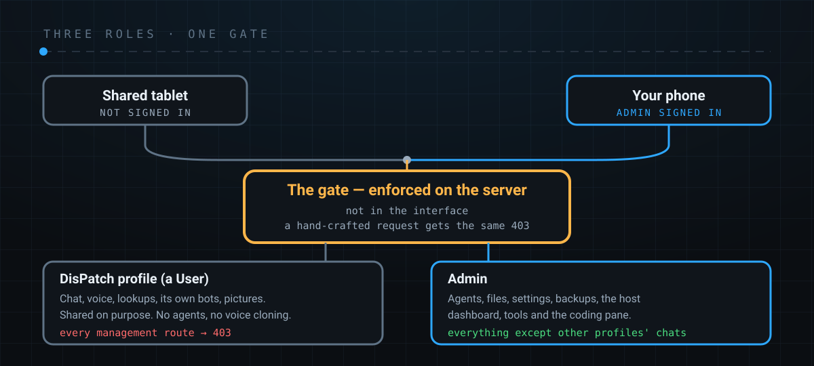
</div>

**Restricted** (formerly "Safe Mode") — what a kitchen tablet or a child's profile
gets, signed in or not. Read and send, but only to the characters whose audience
is *Restricted* or *Everyone*, with media stripped server-side, per-profile daily
budgets, time limits and quiet hours, and a one-way file drop (they can send you a
file; they cannot browse or retrieve anything). Every management endpoint answers
403, and the Owner sees a summary of what the profile did (counts, not content).

**Member, Admin, Owner** — progressively more. A Member chats, uses voice, images
and the tools you enabled. An Admin also manages characters, connections, plugins
and the other profiles. The Owner (formerly "Unlocked") also holds host control:
the full-power agents, files, wipe and export, the host dashboard, and the
DeepSeek Harness pane (when `dsh` is installed) if you turned it on. Running an
agent on the host is its own permission (`dispatch_agents`).

The split is enforced on the server, not in the interface — a Restricted device
that crafts the request by hand gets the same 403 as one that presses the button.
That is the invariant to protect if you contribute: every route and WebSocket
action declares the permission it needs in `backend/app/route_policy.py`, a test
fails the build if one does not, and a permission problem is never fixed by
loosening it. The generated reference is [docs/contracts/](docs/contracts/).

## Bring your own AI

DisPatch ships with no model and talks to no cloud until you tell it to. Making
it answer takes about a minute and needs no agent stack:

1. Open **⚙ Settings → 🔌 AI models**.
2. Choose the bot to connect (Atlas by default, any other direct-API bot, or a
   new one), pick a provider, paste a key if it needs one, press **Test**, pick a
   model from the list, press **Connect**.

That is it. The bot keeps its threads and history and works like every other
conversation in the app. Behind the scenes this fills in the bot's `advisor:`
block, the direct-API backend: a provider chain with fallback, live lookups and
real streaming ([docs/advisor.md](docs/advisor.md)). Bots that still use the
older `api:` block keep working as they did.

Supported out of the box: **LM Studio** and **Ollama** (on your own machine, no
key, nothing leaves the box), **OpenAI**, **Anthropic**, **DeepSeek**, **Groq**,
**OpenRouter**, **Mistral**, **xAI** and **Together** — plus **Custom**, which
is anything speaking OpenAI's `/chat/completions`, so llama.cpp, vLLM, LocalAI
and most corporate gateways work too.

Two honest caveats:

- **Your key is stored once, in the secret store** — the OS keyring when there
  is one, else a `0600` file under the data directory (`agents/secrets.json`);
  never in `config.yaml` (3.0 moves any key it finds there). Other users on the
  box cannot read it, but it is not encrypted on disk, and anyone with your
  account, root, or a copy of your backups has it. If you would rather it were
  not on disk at all, name an environment variable instead and DisPatch reads
  the key from there; the environment always wins over the store.
- **A direct-API bot is an assistant, not an agent.** Its lookups only read
  (search, weather, a page, and so on); it cannot touch files or run anything
  on your machine. For that you want an
  [agent backend](docs/agents.md), which is a bigger commitment and has to run
  on the same host.

Full setup notes, per provider: [docs/llm-providers.md](docs/llm-providers.md).

## Deployment

| Platform | Guide | Notes |
|---|---|---|
| Docker / Compose | [docs/deploy-docker.md](docs/deploy-docker.md) | Recommended. amd64 + arm64 |
| Raspberry Pi | [docs/deploy-raspberry-pi.md](docs/deploy-raspberry-pi.md) | Pi 4/5. Read the SD-card section |
| Windows | [docs/deploy-windows.md](docs/deploy-windows.md) | Native (`uv sync` + `uv run uvicorn`, see Install), or Docker Desktop / WSL2 for a 24/7 service |
| Bare Linux | [docs/deploy-bare-metal.md](docs/deploy-bare-metal.md) | systemd unit, system or user |

### Reaching it from outside your house

DisPatch does not depend on any commercial mesh VPN. The supported ladder, in
order of what most people should pick first, is in
[docs/remote-access.md](docs/remote-access.md):

1. **Reverse proxy with a real certificate** (Caddy + Let's Encrypt DNS-01).
   TLS terminates on *your* hardware.
2. **Behind CGNAT?** A cheap VPS forwarding raw TCP to a WireGuard tunnel. Your
   traffic stays encrypted end-to-end past the VPS — it only sees ciphertext.
3. **LAN only.** Perfectly valid. The docs cover getting real certificates for a
   private network so browsers stop complaining.

The public hostname is the same in all three, which matters: passkeys are bound
to it permanently, so you can change how you reach the box without invalidating
every device.

## Security

Read [SECURITY.md](SECURITY.md) for the reporting process and
[docs/security.md](docs/security.md) for the hardening guide. The short version
of what you are trusting:

- **Your host is the trust boundary.** Anyone with shell access, or read access
  to the data directory, can read everything. The database is not encrypted at
  rest — use full-disk encryption if you need that.
- **Messages are not end-to-end encrypted**, and cannot be while a server stores
  history and hands text to agent backends. Transport is TLS; storage is your
  filesystem. Anyone claiming otherwise about an app shaped like this is
  selling something.
- **Accounts are roles, not walls.** Members share the household's conversations;
  there is no per-person thread ownership yet, and an agent-backed character runs
  with your user's rights on the host (hence the separate `dispatch_agents`
  permission). See [docs/security.md](docs/security.md).
- **Privacy mode** lets a device hold nothing locally: no offline cache, no
  saved settings, no persistent session. See
  [docs/security.md](docs/security.md#privacy-mode).

## Your data

Everything lives in one directory (`~/.local/share/local-chat` by default,
`/data` in the container images, `DISPATCH_DATA_DIR` to move it):

```
data/
├── chats.db                      # SQLite — messages, threads, profiles, devices, sessions, settings, agents
├── media/                        # inline images and video
├── files/                        # file-server attachments
├── avatars/                      # avatar pools drawn by new threads
├── reactions/                    # reaction images: pack, per-bot pools, spent
├── backups/                      # rotating snapshots, integrity-checked
├── logs/
├── config.yaml                   # your bot roster and settings
├── reactions.yaml                # the named, reusable reaction pack
├── reaction-prompts-<bot>.yaml   # per-bot image prompt bank
└── .instance.lock                # single-process guard; ignore it
```

Back it up by copying the directory. Migrate hosts by moving it. Delete it and
DisPatch starts fresh. There is no hidden state anywhere else, and nothing is
transmitted off the machine unless you configure an agent backend that does so.

## Development

```bash
cd backend
uv sync                 # Python 3.12+
uv run pytest           # the test suite (on Linux, or in WSL on Windows)
uv run uvicorn app.main:app --reload --port 8765
```

The full backend suite runs on Linux (use WSL on Windows). Native Windows runs a subset: everything collects and
`-k` or a file path works (`uv run pytest tests/test_route_table.py -q`), but 136 tests fail on a Windows host at
3.0.0 because they depend on POSIX file modes, `/tmp` and process groups. See [docs/development.md](docs/development.md#windows).

The frontend has **no build step** — it is ES modules and CSS served as-is.
Edit a file, reload the page. Cache busting is two moves, not one: bump the
asset's own `?v=N` counter where it is referenced, and bump the `CACHE` constant
in `sw.js` to invalidate the shell.

Before opening a pull request:

```bash
python3 scripts/scrub_check.py      # no private data may enter the repo
uv run --python 3.12 python scripts/check-locales.py   # translations complete, consistent and safe (needs Python 3.12+)
cd backend && uv run pytest -q     # Linux or WSL; on native Windows run a subset (see above)
```

## Roadmap

3.0 shipped the first half of [the multi-user design](docs/design/multi-user.md):
profiles, roles, per-profile budgets and the migration that preserves an existing
install's history. Designed in detail and not yet built:

- **Per-conversation access** — today conversations are one shared household
  space; roles gate actions and characters, not individual threads
  ([docs/design/multi-user.md](docs/design/multi-user.md), "deferred").
- **TOTP and passkeys** ([docs/design/remote-access-and-auth.md](docs/design/remote-access-and-auth.md))
  — a second factor and the honest account of where passkeys help and where they
  cause self-hosting pain. Passwords, PINs and recovery codes exist today.
- **Agents**: Claude Managed Agents (hosted sessions), the generic CLI adapter and
  scheduled tasks ([docs/agents.md](docs/agents.md), "Known limits").

## Translating

Every string lives in `frontend/static/locales/<lang>.json`. Adding a language
is one file and one line — no code. See [docs/i18n.md](docs/i18n.md).
Translation contributions are very welcome and are the easiest way to help.

## License

Copyright (c) 2026 Laser Lloyd. <!-- scrub-ok: the copyright holder is named on purpose — MIT is meaningless without an attributable notice, and this line mirrors LICENSE. -->

[MIT](LICENSE). You can run, modify, share and sell this freely — keep the
copyright notice and the licence text with it, and it comes with no warranty.

The vendored third-party libraries in `frontend/static/vendor/` keep their own
licences (MIT, BSD-3-Clause, Apache-2.0/MPL-2.0) — inventory and full licence
texts in
[frontend/static/vendor/README.md](frontend/static/vendor/README.md).

**Voice chat** is the separate DisPatch Voice add-on (MIT); it carries the
attribution for the speech models and libraries it installs or downloads.
Its optional Kokoro built-in voices are a further plugin licensed
GPL-3.0-or-later. DisPatch itself contains no speech code — see
[docs/extensions.md](docs/extensions.md#voice).
